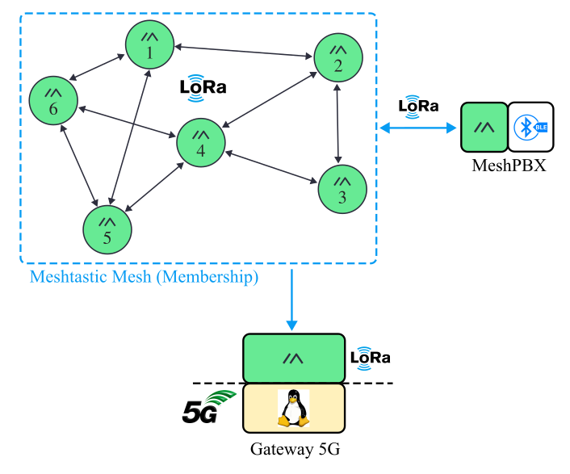

# meshtastic-platform

Configure the radios of a Meshtastic mesh from one file, check that each one
is set up the way that file says, and listen to the mesh to study the channel.



Every radio in green is a member of the mesh — the nodes, and the radio half
of the MeshPBX and of the gateway — and gets its membership from this
platform. The other half of each module (BLE to the phones, the gateway's
Linux host and 5G link) belongs to its own project.

| Program | What it does |
|---|---|
| [`configure.py`](configure.py) | Validates a deployment file, configures a radio from its entry, and reads a live radio back to check it |
| [`receiver.py`](receiver.py) | Channel-study receiver: logs everything a radio hears to the terminal, CSV and JSONL |

The code is the same whatever mesh it drives. Everything about a particular
mesh — its nodes, channels, frequency, sites and power limits — lives in
`deployments/<name>.yaml`, and nowhere else (a test enforces it).

## Setup

```bash
git clone --recursive https://github.com/OF306PUC/meshtastic-platform && cd meshtastic-platform
python3 -m venv .venv && .venv/bin/pip install -r requirements.txt
cp .env.example .env               # channel keys (PSKs); only configure.py reads them
source .venv/bin/activate
```

Nothing is installed: the two programs import the `meshtastic_platform/` and
`channel_study/` folders beside them, from any working directory.

Related firmware and services are pulled in as Git submodules under
`external/` (`git submodule update --init` if you cloned without
`--recursive`):

| Submodule | |
|---|---|
| `external/meshpbx` | [OF306PUC/meshpbx](https://github.com/OF306PUC/meshpbx) |

The gateway (`meshtastic-gateway`: ingestion, delivery ratio, storage,
dashboard) shares no code with this platform. It pairs with it through the
deployment file alone: keep the same file in both repositories — same SHA-256,
which `receiver.py` records in each session.

## Deployments

A deployment file describes one mesh. Start from
[`deployments/_template.yaml`](deployments/_template.yaml) — it documents every
field. In short:

```yaml
meta:   {deployment: my-mesh, kind: field, firmware_target: "2.7.26"}
radio:                              # identical on every radio of the mesh
  region: ANZ
  modem_preset: MEDIUM_FAST
  channel_num: 45                   # the slot, explicit
  channels:
    - {index: 0, name: myPrimary, psk_env: MY_PRIMARY_PSK}   # the PSK itself stays in .env
  rebroadcast_mode: LOCAL_ONLY
  position_precision: 32
  rx_boosted_gain: true
  eirp_caps:                        # the power limits that apply where the mesh runs
    - {band_mhz: [915, 928], eirp_dbm: 27, label: "..."}
nodes:
  - {ref: N1, function: node, hardware: ..., antenna: {...}, intervals: {...}, ...}
```

Each radio has a `function`:

| Function | What it is |
|---|---|
| `node` | A field node: reports its measurements (device, environment, position) at fixed cadences |
| `pbx` | A radio driven over UART by a PBX, a BLE processor (nRF52840 today, nRF54L15 in the board being designed) that lets several phones use the mesh through this one radio. Its `pbx` block records which PBX drives it |
| `gateway` | A radio on a host computer that collects the mesh's data; never relays |
| `receiver` | A radio on a laptop running `receiver.py`; never relays |

Every command takes `-d/--deployment <name>`, where `<name>` is a file in
`deployments/` without the `.yaml`: `-d my-mesh` reads
`deployments/my-mesh.yaml`. A path to a YAML file elsewhere also works, and so
does setting the `MESH_DEPLOYMENT` variable instead of passing `-d`. 

```bash
python configure.py validate -d my-mesh     # every rule the file must satisfy; --all checks them all
python configure.py show     -d my-mesh     # nodes, slot frequency, derived tx_power and EIRP, sites still to fill
```

The transmit power is not typed by hand (check SUBTEL regulations in Chile): it is derived from the antenna gain,
the power limit of the band the slot falls in, and the radio chip's valid
settings, and `validate` refuses a value that differs.

## Mesh membership: what gets configured on a radio

`provision` writes a radio's **membership** in the mesh: everything that makes
it part of the mesh its deployment file describes, and nothing else. All of it
comes from that file. The first group of settings must be identical on every
radio of a mesh — a radio that differs in any of them hears nothing, or hears
packets it cannot read.

A `pbx` radio is a connector between a PBX module and the mesh: the PBX project
configures the connector (the radio's serial link to the PBX and its
Bluetooth), and this platform gives it its membership, like any other radio.
The decision, the PBX connection in detail and a worked example:
[ADR-0002](docs/architecture/ADR-0002-membership-and-connectors.md).

| Meshtastic setting | From the file | What it does |
|---|---|---|
| `lora.region` | `radio.region` | Frequency band and the legal limits the firmware enforces (ANZ: 915–928 MHz) |
| `lora.modem_preset` | `radio.modem_preset` | Bandwidth, spreading factor, coding rate: range against airtime. MEDIUM_FAST = 250 kHz SF9; LONG_FAST = 250 kHz SF11 |
| `lora.channel_num` | `radio.channel_num` | Frequency slot inside the region (1-based). Left at 0, the firmware derives it from a hash of the primary channel name |
| channels: name + PSK | `radio.channels` + `.env` | Index 0 is the primary channel, the rest are secondary channels. Name and key together identify a channel: both must match to decode |
| `device.rebroadcast_mode` | `radio.rebroadcast_mode` | Which packets a node relays. `LOCAL_ONLY`: only those of its own channels |
| `position_precision` (per channel) | `radio.position_precision` | Bits of latitude/longitude sent (32 = full) |
| `lora.sx126x_rx_boosted_gain` | `radio.rx_boosted_gain` | Extra receive sensitivity, SX126x chips only |
| `device.role` | node `role` | `CLIENT`: reports and relays. `CLIENT_MUTE`: never relays others' packets (gateway, receiver) |
| `lora.hop_limit` | node `hop_limit` | How many times a packet it sends may be relayed |
| `lora.tx_power` | derived | See above |
| `telemetry.*` | node `intervals`, `sensors` | Device telemetry (battery, voltage, channel use, airtime) and environment telemetry (only with a sensor), each at its cadence |
| `position.*` | node `intervals.position` | GPS on and position broadcast at that cadence, or GPS off. Smart (movement-triggered) broadcast always off |
| `serial.enabled` | node `function` | Off on every radio except `pbx` ones, whose serial link and Bluetooth are never touched here |

A position is never written to a radio: the surveyed site is a record in the
file, compared later with what the GPS reports.

## Configuring a node

Flash the firmware first: [`docs/flashing.md`](docs/flashing.md). Then:

```bash
python configure.py provision -d my-mesh --node N1 --port /dev/serial/by-id/... --dry-run   # print the plan
python configure.py provision -d my-mesh --node N1 --port /dev/serial/by-id/...
python configure.py inspect   -d my-mesh --node N1 --port /dev/serial/by-id/...
```

`provision` writes role, hop limit, slot, transmit power, cadences, sensors and
channels from the node's entry, and refuses a device that is not the one the
entry describes (another node ID, a different board or firmware). `inspect`
reads the radio back and exits 1 on any difference from the file — run it after
every change. Copy the `node_id`, `mac` and firmware it prints into the file.

When something fails: [`docs/troubleshooting.md`](docs/troubleshooting.md).

## Channel study

The receiver is a radio on a laptop, configured like any other node (a
`receiver` entry in the file, role `CLIENT_MUTE`).

```bash
export MESH_DEPLOYMENT=my-mesh
python receiver.py --port /dev/ttyACM0                                    # terminal only
python receiver.py --port /dev/ttyACM0 --csv runs/2026-11-03/ --operator <name>
python receiver.py --port /dev/ttyACM0 --node N1 --kind environment       # filter
python receiver.py --port /dev/ttyACM0 --raw                              # full packets
python -m channel_study.analysis.plot_session runs/2026-11-03/            # figures (from the repo root)
```

```
HH:MM:SS  ref   kind    hops  RSSI    SNR  payload
────────────────────────────────────────────────────────────────────────
10:42:17  N1    env        0   -78   +9.5  T=22.4C  RH=78%
10:42:31  N2    device    1*  -104   -7.5  bat=87% 4.02V chutil=3.1% airtx=0.42%
── no reception from N3/env for 312 s ──
```

* `hops > 0` and an SNR below what the preset can demodulate are highlighted
  (`*` / `!` without colour). A flow silent for 1.5× its cadence is announced,
  and again when it returns. Rebroadcast copies are marked `(dup)`.
* Recorded per packet: RSSI, SNR, hops, channel, the sender's and the
  receiver's antenna, power and firmware (from the file), and the measurements:
  temperature and humidity, battery level and voltage, channel utilisation,
  airtime, uptime, position.
* Messages: text messages (`TEXT_MESSAGE_APP`) are shown on the terminal and
  written to the files only with `--capture-content`. `PRIVATE_APP` payloads
  (portnum 256 — what a PBX sends) are recorded by size only: decoding them is
  the gateway's job.
* Outputs: CSV (one file per node and kind, plus `gaps.csv`) and JSONL (every
  packet). Each recording also writes `session.json`: who, when, which file
  (with its hash), the receiving radio's settings, the code version, and a
  summary.

The receiver warns at start-up if its radio is not on the file's preset and
slot.

## The decoder

Both programs here read packets through one function,
`meshtastic_platform.decode.decode()` (the gateway keeps a copy of its own). It turns the dictionary the
Meshtastic library hands over for each received packet into a flat
`DecodedPacket`: who sent it, what kind it is (device, environment, position,
text, …), the measurements, and how it arrived (RSSI, SNR, hops). Details and
an example in the module's docstring.

## Tests

The test suite checks the code without a radio, a `.env` or a network, in
under a second; CI runs it on every push. `unittest` (standard library)
discovers every `tests/test_*.py`; `-t .` makes the repository root the import
base, so run it from there.

```bash
python -m unittest discover -s tests -t .      # everything (-v: one line per test)
python -m unittest tests.test_decode           # one file
```

| File | What it checks |
|---|---|
| `test_registry.py` | Loading deployment files, and every validator rule (each one shown to fail) |
| `test_provision.py` | The commands `provision` would send; keys never shown; wrong devices refused |
| `test_inspector.py` | `inspect` exits 1 on any difference from the file |
| `test_decode.py`, `test_decode_golden.py` | `decode()` gives the exact expected values and has no side effects |
| `test_regulatory.py` | Slot frequency, power caps, derived tx_power, key format |
| `test_channel_study.py` | The receiver end to end with simulated clocks: duplicates, silence alerts, outputs, summary |
| `test_scripts.py` | `configure.py` and `receiver.py` run from another directory with nothing installed; every file in `deployments/` validates |
| `test_hard_rules.py` | Reads the source code: no application name in it (the names come from `deployments/`), no downstream infrastructure, no `sys.path` tricks |

The tests build synthetic deployments ([tests/test_registry.py](tests/test_registry.py))
and packets ([tests/fixtures/packets.py](tests/fixtures/packets.py)). Apart
from checking that the real files in `deployments/` validate, they do not
depend on them.

## Layout

```
configure.py  receiver.py     the two programs
deployments/                  one file per mesh — the only place the application lives
meshtastic_platform/
  radio/       presets, slot frequency, power limits, the radio profile built from a file
  registry/    load and validate deployment files; hardware catalogue
  decode/      decode(): received packet -> DecodedPacket
  provision/   configuration plan, device checks, inspector
  cli/         meshtastic CLI runner
channel_study/ receiver logic, sinks (terminal, CSV, JSONL), plots
external/      submodules
docs/          flashing, troubleshooting, diagrams (TikZ; build.sh), testbeds, scalability
tests/
```
