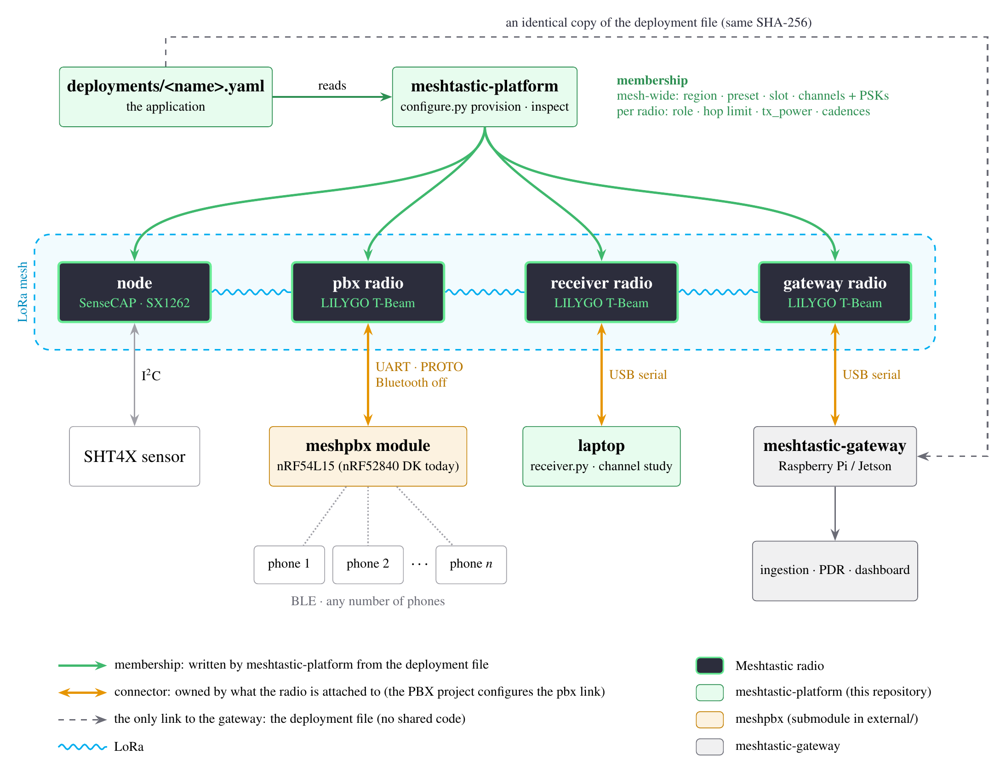
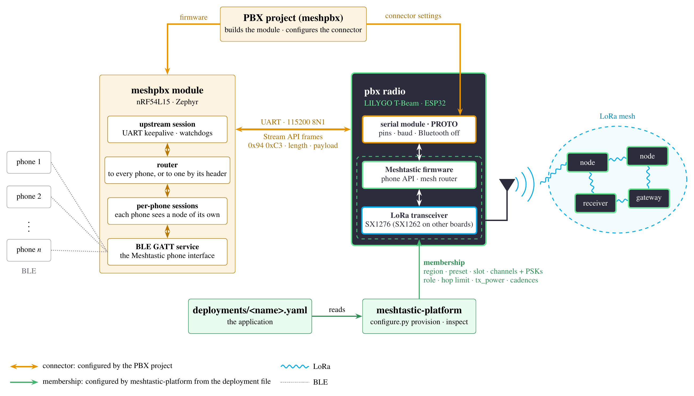

# ADR-0002 — Mesh membership and connectors

**Status:** Accepted
**Date:** 2026-10-26
**Owner:** project owner
**Related:** README § Mesh membership; `docs/diagrams/membership.png`,
`docs/diagrams/pbx-connector.png`; `docs/troubleshooting.md` § A pbx radio lost
its membership; `deployments/san-joaquin.yaml` (p1, p2); `external/meshpbx`;
`meshtastic-gateway` → `GATEWAY-DIRECTIVES.md` §0.1, §5

## Context

Every radio in a Meshtastic mesh carries two kinds of settings:

- what makes it **part of one particular mesh** — region, modem preset,
  frequency slot, channels and their keys, role, hop limit, transmit power,
  broadcast cadences. They come from the deployment the radio belongs to, and
  most of them must be identical on every radio of that mesh;
- what **connects it to whatever it is attached to** — a PBX over UART, a host
  computer over USB, a sensor over I²C. They come from that attached thing:
  its board, its wiring, its firmware.

The question came up with the PBX (meshpbx): a BLE processor — an nRF52840 DK
today, an nRF54L15 board being designed — that lets several phones use the
mesh through one Meshtastic radio, which it drives over UART. Who configures
that radio?

- **The PBX project, entirely.** Its `tools/meshtastic/` scripts did so. They
  carry their own copy of the mesh: channel names fixed in code
  (`telCPS_RTC` / `msgPUC_NET`), `HOP_LIMIT = 1`, no `channel_num` and no
  `tx_power`. On San Joaquín that radio would land on slot 17 (919.125 MHz, the
  firmware's hash of the channel name) while the mesh is on slot 45
  (926.125 MHz) — it would hear nothing — with hop limit 1 instead of 2 and
  transmitting at the chip ceiling, unchecked against the regulatory cap. On
  Rapa Nui, whose channels are `EasterNetT` / `EasterNetM`, it would be wrong
  everywhere.
- **This platform, entirely.** Briefly implemented on 2026-10-26 (a `pbx.uart`
  block with pins and baud rate in the deployment file). It ties every
  deployment file to the PBX board's wiring: each board revision would change
  the files of every mesh it is used in, and the PBX team could not set up or
  test its own link without this repository.

## Decision

Split the radio along those two kinds of settings, and give each to its owner.

**Membership** — written by this platform (`configure.py provision`) from the
deployment file, checked by `configure.py inspect`, for every radio whatever
it is attached to:

| Mesh-wide (identical on every radio) | Per radio |
|---|---|
| region · modem preset · slot (`channel_num`) · channels: name + key (PSK) · rebroadcast mode · position precision · RX boosted gain | role · hop limit · tx_power (derived from antenna, cap and chip) · telemetry and position cadences · environment telemetry on or off (sensors) |

**Connector** — configured by whoever owns what the radio is attached to:

| Radio | Attached to | Connector | Configured by |
|---|---|---|---|
| `pbx` | PBX module | serial module in `PROTO` mode, its pins and speed; the radio's Bluetooth off | the PBX project |
| `gateway` | host computer (Raspberry Pi / Jetson) | USB serial, the radio's default | nothing to configure |
| `receiver` | laptop running `receiver.py` | USB serial, the radio's default | nothing to configure |
| `node` | SHT4X sensor | I²C; the firmware detects the sensor by itself | nothing to configure |

In the code:

- `provision` never writes `serial.*` or `bluetooth.*` on a `pbx` radio, and
  writes `serial.enabled false` on every other radio, so a radio reused from a
  PBX does not keep driving pins nothing listens to.
- `inspect` checks only membership on a `pbx` radio; the PBX project checks
  its link.
- A `pbx` node's `pbx` block is a record — which PBX drives it (`mcu`,
  `firmware`). The loader refuses pins or baud rates there.
- The same split holds for code: the gateway shares no code with this
  platform and pairs with it through an identical copy of the deployment file,
  the source of every radio's membership (`GATEWAY-DIRECTIVES.md` §0.1).



*Membership (green) reaches every radio from the deployment file; each
connector (amber) belongs to what the radio is attached to. The hardware drawn
— SenseCAP, T-Beam, nRF54L15, SHT4X — is that of our meshes, as an example;
the split holds for any Meshtastic radio.*

## The PBX connection in detail



*The PBX module, its UART connector, and the radio whose lower half is the
mesh's (membership) and whose upper half is the PBX's (connector).*

From the phones to the mesh:

1. **Phones ↔ PBX, BLE.** The PBX exposes the Meshtastic phone interface (the
   same GATT service a radio offers), so the stock app connects to it as to a
   radio. Each phone gets a session of its own: the PBX replays the radio's
   configuration to each one, so every phone sees "its" node.
2. **PBX ↔ radio, UART.** One link for all the phones: 115200 8N1, carrying
   the Meshtastic Stream API — the same protobuf messages a phone exchanges
   over BLE, framed as `0x94 0xC3`, two length bytes, payload. On the radio
   this is the serial module in `PROTO` mode. The PBX keeps that one session
   alive (keepalives, watchdogs) and answers locally what must not reach the
   radio once per phone.
3. **Radio ↔ mesh, LoRa.** A member of the mesh like any other radio. The
   stock app's messages go out as ordinary text messages
   (`TEXT_MESSAGE_APP`). An app that addresses phones individually frames its
   messages with a PBX header on `PRIVATE_APP` (portnum 256): 9 bytes in front
   of the content for a frame directed to one phone, 5 for a broadcast.

Who reads those frames: this platform's receiver records portnum 256 by size
only; the gateway decodes them (its `pbx_message` measurement). Text messages
the receiver shows as text.

## Application example: San Joaquín, radio p1

`deployments/san-joaquin.yaml`, entry `p1`: a LILYGO T-Beam (ESP32, SX1276)
at MIDE, driven by an nRF52840 DK.

**Membership** — from the file, by this platform:

| Setting | Value | Why |
|---|---|---|
| region · preset · slot | ANZ · MEDIUM_FAST · 45 (926.125 MHz) | the mesh's; slot 45 falls in the 925–928 MHz band, capped at 30 dBm EIRP |
| channels | 0 `telCPS_RTC`, 1 `msgPUC_NET`, keys from `.env` | the mesh's |
| role · hop limit | `CLIENT` · 2 | relays, and carries its users' messages |
| tx_power | 20 dBm | the SX1276 ceiling; with the 2 dBi antenna, 22 dBm EIRP, under the cap |
| cadences | device 600 s · position 1800 s | what the receiver and the gateway measure it against |

```console
$ python configure.py provision -d san-joaquin --node p1 --port /dev/serial/by-id/... --dry-run
  (abridged)
  [LoRa]     --set lora.region ANZ --set lora.modem_preset MEDIUM_FAST --set lora.channel_num 45
             --set lora.hop_limit 2 --set lora.tx_power 20
  [device]   --set device.role CLIENT --set device.rebroadcast_mode LOCAL_ONLY
  [channels] --ch-set name telCPS_RTC --ch-set psk <psk> ... --ch-index 0
             --ch-set name msgPUC_NET --ch-set psk <psk> ... --ch-index 1
  [telemetry] device every 600 s, environment off
  [position]  GPS on, every 1800 s, smart broadcast off
  [reboot]
```

**Connector** — from the PBX board, by the PBX project:

```console
$ meshtastic --port /dev/serial/by-id/... \
    --set bluetooth.enabled false \
    --set serial.enabled true --set serial.mode PROTO \
    --set serial.txd 15 --set serial.rxd 35 --set serial.baud BAUD_115200
```

GPIO15 (TX) and GPIO35 (RX) are the T-Beam's UART1, wired to the DK's UART1:
GPIO15 → P1.01 (RX), GPIO35 ← P1.02 (TX). On the nRF54L15 board these values change; nothing in the deployment
file does.

The two sets of settings do not overlap, so the order does not matter. Then
`configure.py inspect` checks the membership and the PBX project's
`check_node_info.py` the link.

## Consequences

**Positive**

- One source of truth for membership: a PBX radio joins any mesh — San
  Joaquín, Rapa Nui, a bench — by its entry in that mesh's deployment file,
  with no change to the PBX project.
- The PBX hardware evolves on its own (nRF52840 DK → nRF54L15 board) without
  touching any deployment file.
- The pattern extends to the next attached module — e.g. the mesh-sniffer in
  `docs/scalability/README.md`: a function of its own, membership from the
  deployment file, its link owned by its own project.

**Negative / costs**

- Two tools to set up one PBX radio, in either order.
- Until they are trimmed, meshpbx's radio scripts still write membership too;
  run `configure.py provision` after them (`docs/troubleshooting.md`).
- Deployment files are copied to the gateway by hand; nothing but a SHA-256
  comparison catches a drift.

## Alternatives considered (rejected)

- **The PBX project configures the whole radio** — a second source of truth
  for the mesh, already wrong (slot 17, hop limit 1, no tx_power).
- **This platform configures the whole radio, link included** — couples every
  deployment file to the PBX board's wiring.
- **This platform ignores PBX radios** — then the receiver and the gateway
  cannot attribute their traffic, and their transmit power is never checked
  against the cap.

## Follow-ups

- meshpbx: reduce `tools/meshtastic/` to the connector (owner).
- Record the nRF54L15 board's UART pins in the PBX project when it exists.
- Copy the deployment files to the gateway when it starts using them.
