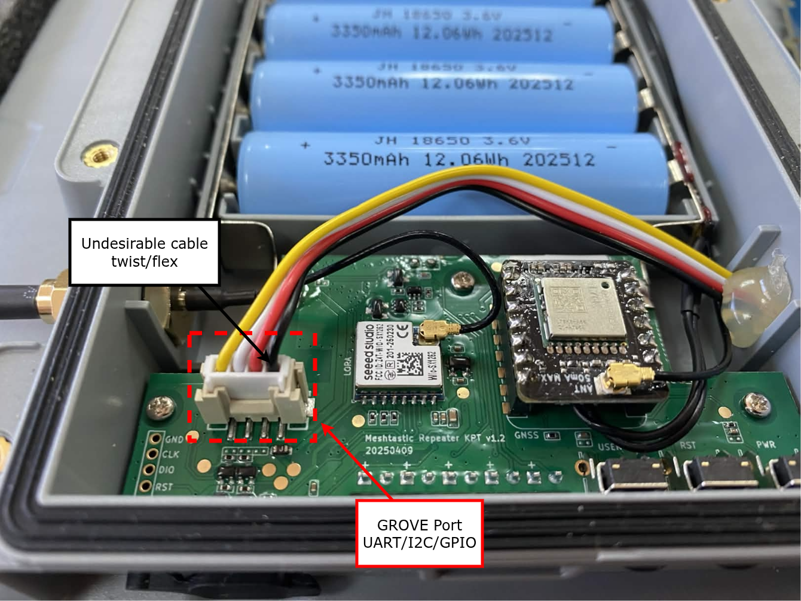
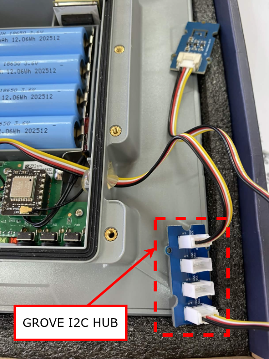

# Troubleshooting

Organised by **symptom**, because that is what you have when you arrive here.

Nearly every failure in this project is a *quiet* one: the radio transmits,
something hears it, the tool exits zero, and the number is wrong. Each entry
says how to tell the causes apart, not just what to change. The pipeline-side
entries (broker credentials, containers, database timestamps) moved to
`meshtastic-gateway` with the code they describe.

| Symptom | Section |
|---|---|
| The channel-study receiver shows nothing | [The receiver hears nothing](#the-receiver-hears-nothing) |
| `validate` rejects `tx_power_dbm` | [tx_power rejected by the validator](#tx_power-rejected-by-the-validator) |
| `provision` refuses the device | [Provisioning refuses the device](#provisioning-refuses-the-device) |
| `inspect` reports a channel the deployment does not declare | [A radio reused from another mesh](#a-radio-reused-from-another-mesh) |
| A pbx radio drifts after the PBX project's scripts ran | [A pbx radio lost its membership](#a-pbx-radio-lost-its-membership) |
| The gateway drops a node, or charges losses the receiver does not see | [The gateway's copy of the deployment differs](#the-gateways-copy-of-the-deployment-differs) |
| A flow shows constant gaps, or 100 % loss | [A flow that never arrives](#a-flow-that-never-arrives) |
| Sensor detected at `0x44`, no temperature or humidity | [I2C sensor detected but no telemetry](#i2c-sensor-detected-but-no-telemetry-sht4x) |
| Every node reports the same coordinates | [Positions all identical](#positions-all-identical) |
| Serial port busy, or the board reboots when you connect | [Serial port contention](#serial-port-contention) |
| `WriteFile failed` / `Aborting due to` on the last step | [The reboot step fails on Windows](#the-reboot-step-fails-on-windows) |
| `track.csv` is missing, empty, or always the same point | [The GPS track is empty or frozen](#the-gps-track-is-empty-or-frozen) |
| `ToPhone queue is full, drop packet` in the device log | [The radio drops packets before the recorder sees them](#the-radio-drops-packets-before-the-recorder-sees-them) |

---

## The receiver hears nothing

**Symptom.** `python receiver.py` starts, prints its header, and
no line ever appears.

A receiver on another preset, slot or PSK receives **nothing** — no error, just
no packets. At start-up the receiver compares its radio against the deployment
and prints a `WARNING: receiver <setting> is ... deployment expects ...` line
for every mismatch; read the lines above the header first. Then:

```bash
python configure.py inspect -d <name> --port <receiver port>
```

The `Radio` section shows region, preset, `channel_num`, channel names, PSKs
(match/mismatch only) and precision. Fix with
`python configure.py provision -d <name> --node R1 --port ...`.

If the radio matches and still nothing arrives, check the session counters
printed on Ctrl+C: **undecryptable** packets mean something is transmitting on
your frequency with a different PSK (another mesh, or a node with a stale
`.env`) — that is occupancy, and worth recording.

---

## tx_power rejected by the validator

**Symptom.** `python configure.py validate` reports
`V2 ... tx_power_dbm is X, policy requires Y`.

`tx_power` is **derived, not chosen**: in a field deployment it is
the highest valid chip setting not above `floor(cap − antenna gain)`, where the
cap is the deployment's `eirp_caps` entry for the band the slot falls in.
Common causes:

* the antenna was swapped (or its gain corrected) and `tx_power_dbm` was not;
* the slot moved to a band with a lower cap — e.g. from a 30 dBm band to a
  27 dBm one drops a 5.8 dBi antenna's node from 22 to 21 dBm;
* on the bench, any value other than the chip minimum (2 dBm on the SX1276
  T-Beams) is refused: radios on a desk at field power saturate each other;
* on a T-Beam (SX1276), 18 and 19 dBm are refused: its driver rejects them and
  the node records a critical error.

Write the value the message gives, then re-validate. `python configure.py show`
prints the derived power and EIRP for every node.

---

## Provisioning refuses the device

**Symptom.** `python configure.py provision` prints `REFUSING to provision`.

It refuses rather than improvise, because a wrongly provisioned node keeps
transmitting and its error surfaces weeks later. Read the reason:

| Message | Meaning |
|---|---|
| `device on the port is !X, but N1 is !Y` | Another device is on the port, or the registry is wrong. Find out which; nothing is overwritten. |
| `... wrong device on the port` (WiFi / MCU) | An ESP32 where the entry says nrf52840 (or the reverse): typically a bench LILYGO plugged in instead of a field SenseCAP. |
| `device runs firmware ... flash first` | Off-target firmware: see [`flashing.md`](flashing.md). |
| `device !X is B3 in deployment bench-lilygo` | The device belongs to another deployment under another ref. |

**Identify the port before trusting it.** On Linux, `ttyACM*` numbering is
enumeration order, not identity: pass a `/dev/serial/by-id/...` path, which is
stable per device. Windows (`COM3`, `COM4`…) and macOS (`/dev/cu.usbserial-…`)
have no such stable alias, so with more than one radio plugged in, confirm
which is which — `python configure.py inspect -d <name> --port <port>` prints
the device's `node_id`, and `inspect` with no `--port` lists every radio it
finds when there is more than one.

---

## A radio reused from another mesh

**Symptom.** After `provision`, `python configure.py inspect` reports
`channel N: expected=none actual=<name>`.

Provisioning writes each declared channel at its own index (`--ch-set ...
--ch-index i`), so the deployment's channels end up right whatever the radio
held before. It does not delete channels the deployment does not declare: a
radio that came from a mesh with more channels keeps the extra ones, and keeps
decoding — and, unless `rebroadcast_mode` says otherwise, relaying — that
mesh's traffic. Remove each one the inspector names, highest index first, then
inspect again:

```bash
meshtastic --port /dev/serial/by-id/... --ch-index N --ch-del
```

`--ch-add` is not used on purpose: it takes the first free slot, so on such a
radio it would put a channel on the wrong index and leave the old one in place.

---

## A pbx radio lost its membership

**Symptom.** `python configure.py inspect` on a pbx radio reports
`channel_num`, `hop_limit`, `tx_power` or channel names different from the
deployment, after the radio was configured from the PBX project.

The PBX project owns the radio's link to the PBX (serial module, Bluetooth);
this platform owns its membership in the mesh. Scripts that write both — such
as the radio scripts in `external/meshpbx/tools/meshtastic/` today — leave the
membership they carry: no `channel_num` (so the firmware hashes the channel
name to another slot: 17 = 919.125 MHz instead of 45 for `telCPS_RTC` on
MEDIUM_FAST), their own hop limit, no `tx_power`. The radio then hears nothing
from the rest of the mesh. Restore the membership — `provision` does not touch
the serial module or Bluetooth of a pbx radio, so the link survives:

```bash
python configure.py provision -d <name> --node <pbx ref> --port /dev/serial/by-id/...
```

---

## The gateway's copy of the deployment differs

**Symptom.** The gateway drops a node's packets as an unknown sender,
publishes it under another name, or reports losses (or `cadence_violated`)
that the channel-study receiver does not show.

`meshtastic-gateway` shares no code with this platform: it reads its own copy
of the deployment file, and nothing keeps the two copies equal. A `node_id`,
label or cadence changed here and not there makes the gateway measure against
the wrong file, silently. Compare them:

```bash
sha256sum deployments/<name>.yaml external/meshtastic-gateway/deployments/<name>.yaml
```

The hash must also match the `sha256` in the session's `session.json` and the
one the gateway prints at start. Copy the file over; never edit the gateway's
copy alone.

---

## A flow that never arrives

**Symptom.** The receiver announces `no reception from N3/env` over and over, or
a PDR estimator downstream reports ~100 % loss for one flow.

First check the registry, not the radio: a node that does **not** carry a
sensor must not declare `environment` in `intervals` (validator V3b). Declaring
a flow a node never emits fabricates 100 % loss, indistinguishable from a dead
node. With 3 of 6 SenseCAP sensorised, this is the easiest invariant to break.

Then the radio: `inspect` compares `telemetry.environment_measurement_enabled`,
the update intervals and `position_broadcast_secs` with the registry. A LILYGO
indoors without a GPS fix sends no position packets at all — if that is the
bench's situation, drop `position` from its intervals rather than measure a flow
that cannot arrive.

---

## I2C sensor detected but no telemetry (SHT4X)

**Symptom.** The node reports detecting an SHT4X at address `0x44`, but no
temperature or humidity is ever received.

<table><tr>
<td align="center" width="30%">
  
  <br/><em>Grove port on the node board. Note the cable twist at the connector.</em>
</td>
<td align="center" width="30%">
  
  <br/><em>Grove I2C Hub inside the enclosure.</em>
</td>
</tr></table>

The bus scan and the driver init are **separate steps**. The scan only checks for
an ACK at `0x44`. Init then reads the sensor's serial number via `readSerial()`,
and if that read fails the sensor is dropped from `nodeTelemetrySensorsMap`
permanently — there is no retry at runtime. A cable twist at the Grove connector
makes contact marginal enough to pass the short ACK and fail the multi-byte
read; a Grove I2C Hub adds capacitance that degrades it further.

> **`SHT4X found at address 0x44` is not a reliable indicator that telemetry will
> flow.** Read the two lines after it instead.

| After `Init sensor: SHT4X` | Failure | Success |
|---|---|---|
| Next line | `Error trying to execute readSerial()` | `serialNumber : 11d75c14` |
| Result | `Can't connect to detected SHT4X sensor` | `Opened SHT4X sensor on i2c bus` |

What to try: relieve the cable twist; reseat every Grove connector at both ends
and power-cycle; connect the SHT4X directly to the Grove port, no hub. I²C over
a plain cable is reliable only for short runs; for 1–3 m it needs a
differential extender.

---

## Positions all identical

**Symptom.** Every node reports the same latitude and longitude, or nodes
hundreds of metres apart plot on the same point.

Their channel `position_precision` is reduced. Coordinates travel as int32 in
units of 1e-7 degrees and the setting keeps only the top bits, so the detail is
**masked off by the sender before transmission** (precision 14 snaps to a
~2.9 km grid). It is invisible in `meshtastic --info`, which omits a field
holding its default. The inspector reads it back per channel and flags remote
nodes whose received coordinates sit on a power-of-two grid:

```bash
python configure.py inspect -d <name> --port /dev/serial/by-id/...
```

Provisioning sets precision 32 on both channels of every device, receivers and
gateway included — the mask is applied by the sender. **Already-stored
positions cannot be recovered**; that is what the registry's `surveyed`
positions are for.

---

## The reboot step fails on Windows

**Symptom.** Provisioning runs through every setting, then the last step prints

```
Running: meshtastic --port COM4 --reboot
Connected to radio
Aborting due to WriteFile failed (PermissionError(13,'The device does not recognize the command.',None,22))
```

**The settings are written.** `--reboot` is the last step of the plan and writes
no setting; everything before it already committed. `provision` says so when the
reboot is the only failed step.

What the message is: pyserial raising on a Win32 `WriteFile` that returned
error 22 (`ERROR_BAD_COMMAND`). That is what writing to a `COM` port looks like
once the USB device behind it has gone away — which is what a radio does when
it reboots. The command and the reboot race each other, and on Windows the
write loses.

It cannot be told from the message alone whether the radio got the reboot
command before it went away. The remedy is the same either way:

```bash
python configure.py inspect -d <name> --node <ref> --port COM4
```

If the radio answers and `inspect` exits 0, it rebooted and is configured. If
it does not answer, power-cycle it (unplug the USB) and inspect again. Settings
that only take effect after a reboot are applied by that power-cycle.

---

## The GPS track is empty or frozen

**Symptom.** A recorded session has no `track.csv`, or it has rows whose
`repeated` column is 1 all the way down, or `plot_session` prints
`[SKIP] no GPS track from the receiving radio`.

The receiver samples its own fix over USB every `--track-secs` seconds (30 by
default) and writes `track.csv` next to the data. Read the start-up lines and
the counters printed on Ctrl+C — `own position: N fixes in M samples every 30 s`
— and work down this list:

| What you see | Cause |
|---|---|
| No `track.csv` at all | No `--csv`/`--jsonl`: a track has nowhere to go. Or `--track-secs 0`. |
| `WARNING: --track-secs is set but this radio's position.gps_mode is DISABLED` | The receiver's entry declares no `position` flow, so `provision` turned the GPS off (`position_settings`). Declare one and re-provision. |
| `0 fixes in M samples` | The GPS is on but has no fix. Minutes of this is normal: a cold start needs open sky, and indoors a LILYGO never gets one. Tens of minutes under open sky, or hours at a window, is a fault — see [A GPS that never fixes](#a-gps-that-never-fixes). |
| Every row `repeated=1` | Nothing new is arriving: the radio keeps handing over the identical fix, GPS timestamp included — its GPS stopped updating, or it lost the fix and kept the last one. A receiver that is merely parked is NOT marked, because its timestamp advances. `position.gps_update_interval` is 30 s on a receiver, so a `--track-secs` shorter than that repeats by construction. |
| `read errors` in the counters | The serial link failed mid-session. The packets in the same session are fine; the track has holes. |
| `gps_mode is NOT_PRESENT` | That board has no GPS chip at all. Do not declare a position flow for it; record its point in `site` instead. |

**A GPS that never fixes.** A healthy NEO-6M cold-starts in a few minutes with
half the sky in view, so hours without a fix is not a weak-signal problem. Work
from the cheapest check to the most expensive:

1. `python configure.py inspect -d <deployment> --port <port>`. If
   `position.gps_mode` reads `NOT_PRESENT`, the firmware probed the GPS UART at
   boot and found nothing. Forcing it to `ENABLED` changes nothing: the module
   is unreachable, not idle.
2. `meshtastic --port <port> --noproto` leaves the serial line in dumb mode
   printing the device's own log, and the boot lines say whether the GPS was
   detected and at what baud rate. This is the one check that separates "no
   module" from "module with no sky"; everything below is only worth doing once
   it has answered.
3. The GPS antenna. Several LILYGO T-Beam revisions bring the GPS out to a u.FL
   connector and ship the small ceramic antenna loose in the box; with that
   connector empty the module never fixes, window or not. Check too that the
   LoRa and GPS antennas are not swapped — the board is happy either way and
   says nothing.
4. The firmware variant. The T-Beam exists in revisions whose GPS sits on
   different pins and, on the AXP192 boards, behind a power rail the firmware
   has to switch on. The wrong variant gives exactly this symptom: radio fine,
   GPS absent. `lilygo_tbeam_sx1276` takes the `TBEAM` target
   (`registry/hardware.py`); see [flashing.md](flashing.md).
5. A counterfeit module. Cheap T-Beams have shipped with fake u-blox GPSs that
   never fix or need very long cold starts. If the log shows the module
   detected, the antenna is connected and half an hour of open sky still gives
   nothing, suspect the chip: record that node's point in `site` instead and
   stop declaring a position flow for it.

**Reading the GPS log.** `U-blox 6 detected`, with a soft and hard version
printed above it and `GNSS module config saved!` below, settles 1, 2, 4 and 5 at
once: the module is genuine, the pins are right and the firmware is driving it.
What matters after that is the satellite count in the line the GPS repeats,
`Publish pos@... hasVal=0, Sats=0, GPSlock=0`. Watch it for ten or fifteen
minutes, not three seconds — `Sats=0` right after boot means nothing. A count
that climbs (1, 3, 5...) and no lock is sky: wait, or go outside. A count nailed
to 0 for a quarter of an hour, with the module detected, is the antenna path —
the u.FL unseated, the antenna broken, or the wrong one fitted — not the sky and
not the firmware. `lat=0 lon=0` in those lines is the firmware saying it has no
lock, which is why the tracker discards (0, 0) and counts it.

Until the hardware is settled, record with `--track-secs 0`. The packet data
does not depend on the GPS, and the channel study loses nothing but the map.

**A radio that arrives with a fixed position.** The Meshtastic CLI turns
`position.fixed_position` on implicitly whenever someone sets a latitude and
longitude, and such a radio then reports those stored coordinates while its GPS
runs — the track follows the GPS, the mesh is told something else.
`provision` writes `position.fixed_position false` on every radio, so
re-provisioning is the fix; `meshtastic --port <port> --remove-position` also
clears the stored coordinates.

A track costs no airtime — the fix travels up the USB cable, not over LoRa.
What does cost airtime is the `position` flow itself, which is why it is
normally declared long (one packet an hour) while `--track-secs` stays short.

---

## The radio drops packets before the recorder sees them

**Symptom.** The device's own log (`meshtastic --port <port> --noproto`) shows

```
WARN | [Router] ToPhone queue is full, drop packet
```

**What it means.** The firmware buffers packets destined for its client — our
receiver — in a bounded queue and drops the oldest when nobody drains it. Those
packets were demodulated correctly and are lost between the radio and the
recorder, so they are invisible to `receiver.py`: they appear as channel loss in
`gaps.csv` and depress the delivery ratio, when nothing was lost on the air.
This is the one measurement error in the channel study that the data cannot
reveal on its own.

**Under `--noproto` it is expected**: that mode deliberately does not start the
API, so no client drains the queue and the warning is the queue doing its job.
Use `--noproto` to read the radio's log, never while recording.

**While recording it is a fault.** Check, in this order, that nothing else holds
the port (see [Serial port contention](#serial-port-contention)), that the
receiver process is not blocked — a sink writing to a slow or full disk stalls
the read loop — and that the machine is not swapping. If a session logged this
warning, say so in the session notes: the delivery figures for that run are a
lower bound, not a measurement.

## Serial port contention

**Symptom.** A tool fails to open the port, or a board reboots the moment
something connects to it.

**Only one process can hold a serial port**: a running receiver, a gateway
container, a Web Flasher tab or a serial monitor all count. Stop the other
holder first.

**Opening a LILYGO's USB console resets the board**: the ESP32 auto-reset
circuit is driven by the serial control lines, so connecting is itself a reboot.
Harmless for provisioning or a session; it does mean a receiver restart resets
the receiving radio, which shows up as a short gap at the start of the session.
